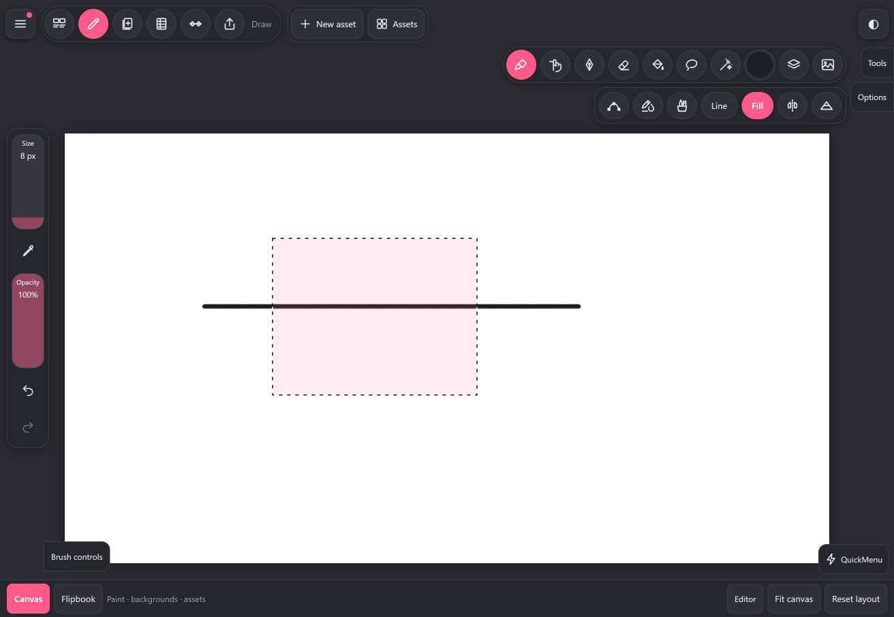

# Draw capability audit and next steps

2026-10-26 · source audit, official handbook comparison and focused desktop browser review.

Application baseline: `main`, `c870fbf00119fee4430f9e944fdfa1d7dbf9510a` (`0.0.2`). Git was clean at the start. This audit adds documentation and one browser screenshot; it implements no drawing features. The adjacent `reference/` projects were not changed or used as app dependencies.

## Finding

Draw already has the basic selection shapes and affine transforms. The most useful next work is making selections a dependable part of painting: easier selection construction, painting/erasing/smudging inside the selection, and adjustments limited to the selection. Advanced tools can then build on that foundation.

Two current behaviors explain part of the perceived tool gap:

1. Select uses two cycling icon buttons for shape and combination. A new selection immediately enters Transform, replacing the selection toolbar. Copy, Add/Subtract and other selection actions return after Apply or Cancel. This was observed in Chrome.
2. A visible selection limits fills, but ordinary painting is unrestricted. A brush stroke crossed both sides of a selected rectangle in Chrome. This is also explicitly documented in the existing Studio hint (`src/ui/panel.ts:430`), so it is an existing limitation, rather than evidence of a recent regression.

The screenshot shows the selected rectangle and a black stroke extending beyond both boundaries. It was captured on a disposable local project, not a user artwork project.

## What the current version contains

The following is a source-backed inventory. Only the focused selection flow described under Verification was exercised anew in the browser.

| Area | Implemented now | Main code |
|---|---|---|
| Painting | Raster Brush, Eraser, Smudge; editable Vector pen; separate Line and Fill planes | `src/app.ts`, `src/brush/raster.ts`, `src/brush/vector.ts` |
| Brush controls | Size/opacity; pressure, tilt and speed dynamics; smoothing/stabilisation/motion filtering; taper, image tips, grain, colour dynamics and a wet-pull parameter | `src/core/brush.ts`, `src/brush/`, `src/ui/panel.ts`, `src/ui/sidebar.ts` |
| Brush library | Ten built-in presets across Sketching/Inking/Painting, personal brushes and collections, Favorites/Recent, per-brush working size/opacity, import | `src/core/brushlib.ts`, `src/core/brushprefs.ts`, `src/ui/brushlib.ts`, `src/io/brushimport.ts` |
| Selection shapes | Freehand loop, Rectangle, Ellipse, Automatic between ink boundaries | `src/app.ts:1452`, `:1481`, `:1504`, `:2389` |
| Selection construction | New, Add, Subtract; Invert, Select all, Deselect; select layer contents | `src/app.ts:1218`, `:1488`, `:1519`; `src/ui/bubbles.ts:643` |
| Selection actions | Fill, Copy, Cut, Paste, Duplicate and Delete, operating on the active drawing | `src/app.ts:1534` through `:1681` |
| Transform | Move, uniform/freeform scale, rotation with 15-degree drag snapping, 45-degree buttons, horizontal/vertical flip, Fit, Reset, Apply/Cancel | `src/app.ts:1257`, `:1655`, `:5176`; `src/core/selxform.ts`; `src/ui/bubbles.ts:585` |
| Fill | Connected regions, gap closing, under-line coverage, leftovers, across following drawings, reference lines, ColorDrop, solid/linear/radial styles and editable gradients | `src/fill/`, `src/app.ts:1178`, `:1976`, `:2255`; `src/ui/panel.ts:314` |
| Ink & Paint | Optional paint of newly enclosed regions after pen-up; selection bounds the automatic paint component | `src/fill/autopaint.ts`, `src/app.ts:4490`; `src/ui/inkpaint.browser.ts:83` |
| Colour | Disc/values, hex, recent colours, named palettes, extraction from an image, colour harmony and eyedropper | `src/ui/colorpanel.ts`, `src/core/color.ts` |
| Drawing assists | QuickShape and point editing; symmetry; grid/isometric/one- and two-point perspective guides and assisted straight drawing | `src/core/quickshape.ts`, `src/core/vecedit.ts`, `src/core/guides.ts`, `src/app.ts:1879` |
| Layers | Opacity/blend, Line/Fill visibility, Alpha Lock, clipping masks, editable layer masks, Reference, groups, multi-layer selection, merge/duplicate | `src/ui/layercards.ts`, `src/compedit.ts`, `src/view/composite.ts` |
| Adjustments | Hue/saturation/brightness and Gaussian blur on the current drawing; preview, Apply/Cancel | `src/app.ts:1729`, `src/core/adjust.ts` |
| Reference and navigation | Floating image/live-canvas reference, zoom/pan/rotate, canvas flip, QuickMenu, configurable student tool visibility | `src/ui/reference.ts`, `src/ui/quickmenu.ts`, `src/ui/settings.ts` |

Brush import is a translation into 2Dope brush settings, not proof of native Procreate brush-engine equivalence. The handoff reports generated import fixtures, with real Procreate/Photoshop brush validation still outstanding. This audit did not repeat imports.

## Selection and transform limits

| Capability | Current boundary | Consequence |
|---|---|---|
| Paint inside selection | Raster stroke input does not pass a selection clip to the raster engine. Vector pen, eraser and Smudge also have no shared selection constraint. Brush overflow was reproduced; the other paths were inspected in source. | A selection is currently useful for fill/manipulation, but cannot be treated as a general painting stencil. |
| Adjust selected area | `beginAdjust` captures the drawn area; `previewAdjust` changes its planes and all vector colours for HSB, without applying `spatialSelection`. | A selected region does not isolate HSB/blur. |
| Automatic selection | Uses `fillFrom(fillMapFor(...))`: line alpha, gap and under-line settings. | This is ink-enclosure detection, not a colour-similarity wand for painted regions or photographs. There is no dedicated live selection-threshold drag. |
| Freehand | The pointer gesture closes into a polygon when it ends. | No tap-to-place polygon nodes or unfinished multi-gesture path building. |
| Mask edges | `polygonMask`, combinations and `transformMask` use binary 0/1 masks. | No feathered coverage; changing mask storage alone would be insufficient because consumers use boolean checks, bitwise operations or `=== 1`. |
| Scope | `spatialSelection` belongs to one project/comp/layer/drawing/frame and is invalidated when that identity changes. | No saved/reloaded selections or intentional reuse across layers/frames. This protects against a stale mask being applied to another drawing. |
| Selection history | New/Add/Subtract/Invert/Deselect mutate temporary state without a selection command. Pixel edits have History commands; transform commands retain before/after selection state. | No independent undo of selection construction. Ordinary Undo must not be described as selection-step Undo. |
| Raster/vector boundary | Copy/delete/transform include a vector stroke only when every recorded point is inside the mask. Widths are scaled by an overall factor. | A crossing vector stroke stays whole; selected portions are not extracted. Point containment also does not establish full outline/curve containment. Freeform does not deform an editable stroke outline exactly like a bitmap. |
| Paste/Duplicate | Paste stamps Line/Fill and cloned vectors into the active drawing; Duplicate calls Copy then Paste. | There is no dedicated “Copy to new layer” or “Cut to new layer” selection action. |
| Transform precision | Canvas handles plus scale/rotation range sliders in Studio. The main options have coarse buttons. | No typed X/Y, width/height or angle fields, side handles, configurable pivot, canvas-edge/centre alignment snapping or nudge controls. Existing vector-point snapping is separate. |
| Resampling | `transformRegion` uses bilinear sampling from the session's original pixels for previews. | No Nearest/Bicubic choice. Successive committed transforms can still degrade pixels. |
| Canvas boundary | Raster results are clipped to the fixed canvas bounds; vector geometry can retain coordinates outside the page. | Off-canvas raster content is lost on Apply (Undo restores it); retained vector geometry behaves differently. Do not promise general lossless off-canvas editing. |
| Deformation | Affine scale/rotation/translation/flips only | No interactive perspective Distort, mesh Warp or Liquify brush. The existing animated turbulence effect is a separate layer effect. |

Selection pixel actions generally include both Line and Fill, plus qualifying vectors. They should not be presented as operations on only the currently chosen painting plane. Mask-edit targeting also needs an explicit review before extending selection actions: layer-mask painting and artwork selection currently follow different paths.

## Official Procreate comparison

Reviewed online on 2026-10-26. These are documented behaviors, not measurements of Procreate internals or firsthand iPad testing.

- [Selection interface](https://help.procreate.com/procreate/handbook/selections/selections-interface): feathering, stored selections and copying selected content onto a new layer extend the basic selection modes.
- [Freehand](https://help.procreate.com/procreate/handbook/selections/selections-freehand): supports connected tap-defined polygon edges and freehand input, followed by painting, smudging or erasing inside a committed selection.
- [Automatic](https://help.procreate.com/procreate/handbook/selections/selections-automatic): allows threshold changes during selection and adding regions with further taps.
- [Advanced selections](https://help.procreate.com/procreate/handbook/selections/selections-advanced): previous-selection recall, saved selections and selecting layer contents.
- [Transform interface](https://help.procreate.com/procreate/handbook/transform/transform-interface-gestures): distinct transform controls, bounding-box nodes and precise entry.
- [Snapping](https://help.procreate.com/procreate/handbook/transform/snapping): alignment against canvas/content, with separate snapping and axis-constrained magnetics.
- [Interpolation](https://help.procreate.com/procreate/handbook/transform/transform-interpolate): Nearest, Bilinear and Bicubic choices and the quality consequences of repeated transforms.

The earlier `SELECTION-TRANSFORM-MANUAL-STUDY.md` is historical: its “not implemented” statements predate the present selection and transform code. It remains useful context, not the current inventory.

REA was not needed for this pass: 2Dope has editable source, and the official manuals establish the reference behaviors above. No installed Procreate build or `.ipa` was supplied or inspected. REA can help later with a specific accessible reference artifact/runtime and a concrete unanswered question; it would not itself verify Apple Pencil feel or iPad performance.

**Addendum, later on 2026-10-26:** a local Procreate 5.4.9 package was then supplied and read with REA. [docs/research/procreate-5.4.9/README.md](research/procreate-5.4.9/README.md) records the result: package identity, no in-app-purchase code, and shipped class/interface vocabulary for saved selections with thumbnails, live wand threshold, feather preview with a single commit, and angular-versus-Cartesian snapping. It confirms the reference behaviors above but adds no runtime evidence, no method bodies (Windows Ghidra does not admit iOS Mach-O) and does not change the plan below.

## Proposed implementation order

These are recommendations for follow-up work, not implemented features.

### 1. Finish the selection workflow

- Give Select a labeled shape chooser and explicit New/Add/Subtract choices. Keep compact layouts scrollable and touch targets usable.
- Keep a newly created selection in selection mode. Enter Transform through its own action. Preserve Apply/Cancel recovery and the current drawing/clock ownership rules.
- Add a shared selection-coverage contract for raster Brush/Eraser/Smudge and HSB/Blur. Show an unambiguous indication when painting is constrained.
- First specify how Vector and vector erasure treat crossing strokes, mask editing, symmetry and QuickShape replacements. Preserve editability; do not silently flatten strokes as a shortcut.
- Add a way to restore the last selection in the same valid drawing context. Keep this temporary until document persistence is explicitly designed.

Suggested first deliverable: explicit selection controls, deliberate entry into Transform, and hard-edged raster painting constrained to the active selection, with one Undo per stroke. Include a clear Vector limitation or a complete vector-boundary implementation; never imply universal clipping based only on raster behavior.

### 2. Add practical selection editing

- Tap-to-place polygon lasso; undo the latest selection construction step.
- Dedicated colour-similarity Automatic mode with live threshold; retain the useful “between ink lines” behavior as a distinct choice.
- Copy/Cut to a new art layer, preserving Line/Fill, vector data and the current drawing's timing relationships.
- Feather, expand and contract. Feather requires fractional mask coverage applied consistently to paint, erase, smudge, fills, transforms, copy/delete and adjustment blending. A soft overlay alone does not implement it.
- Saved selections, with explicit ownership and size checks. Durable storage requires schema validation, bounded memory and complete archive handling where applicable.

### 3. Improve transform quality and precision

- Typed position/dimensions/angle, pixel nudge, side handles and a clear Uniform/Freeform choice.
- Canvas centre/edge snapping and optional constrained movement.
- Nearest for pixel-art transforms alongside Bilinear; assess Bicubic with translucent-edge tests and device cost.
- Decide raster overflow retention before promising off-canvas recovery. Preserve preview from the original source and a single Apply command.

### 4. Expand creative tools

- Curves, colour balance and gradient-map adjustments, using the selection foundation.
- Perspective Distort, followed by mesh Warp.
- Liquify and Clone as separate tools with their own performance and cancellation contracts.
- More expressive smudging/wet paint and validated real brush imports after the basic editing workflow is dependable.

Editable text is another independent drawing-workflow candidate; it requires font, text-model and export decisions. It is not needed to deliver the selection work first.

## Architecture and acceptance gates

- Keep Draw/Animate on the same project and comp clock. A selection of pixels is distinct from exposure or multi-layer selection.
- Reuse History and document-change notification. Preview/cancel must restore pixels; each committed gesture must autosave and Undo/Redo as one edit.
- Respect resident/parked drawing ownership. Masks and buffers need memory budgets at Lite/Full page sizes; avoid fresh full-page allocations per input point.
- Preserve separate Line/Fill, editable vectors, Alpha Lock, clipping and layer masks. Coverage should apply before the layer's existing compositing stages.
- Preserve seeded brush randomness and predicted-input separation. Replacing QuickShape must replace the same constrained stroke and its automatic paint.
- Source changes need meaningful pixel regressions and the full build. Test painting outside/inside a selection on both planes; erase/smudge; translucent edges; symmetry; Cancel/Undo/Redo; frame/layer switches; locked/loading drawings; and selection plus masks/Alpha Lock.
- Touch-width layout and desktop pointer checks are necessary. Physical iPad/Pencil pressure, palm handling, memory and feel remain device checks.
- Update `manualtext.ts`/UPDATES when behavior is implemented. Research alone does not warrant a feature release note.

## Verification in this audit

- `npm test`: **59 files / 488 tests passed**. Existing coverage includes five selected-fill tests and fifteen selection-transform tests. These do not establish complete App/UI selection coverage.
- `npm run build`: strict TypeScript and Vite production build passed. The existing large-chunk warning remains.
- Chrome at isolated `http://127.0.0.1:5227/`: created `Draw audit 2026-10-26`, 1280×720, 12 fps, one frame. Opened Select, cycled Freehand to Rectangle, dragged a rectangle, observed immediate Transform, applied the unchanged transform, observed selection actions return, chose Brush and dragged across the selected rectangle. Painting appeared on both sides of the mask. No warning/error entries were returned by the tab log query.
- Saved `docs/draw-audit-2026-10-26.png` as visual evidence. The browser briefly offered QuickShape after the slow automated straight stroke; clipping failure was visible regardless of that offer.
- The first sandboxed loopback server was unreachable from browsers. The browser check used a local-only server outside the sandbox. No existing-origin storage was cleared.
- No complete browser fixture suite, save/reopen round trip, iPad/Pencil test, deployed-site comparison or REA runtime inspection was performed. Eraser/Smudge/adjustment gaps and vector restrictions above are source findings, not new browser demonstrations.
- No application source, dependencies, file schema or reference project changed. No commit, push or deployment.

**Immediate next task:** implement and verify the bounded first selection deliverable above after the user chooses to proceed from this exploration.
