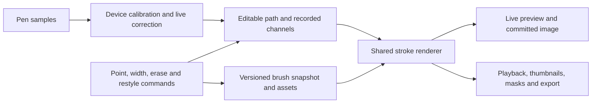

# Editable vector brushes for 2Dope: proposed implementation

2026-10-30. Historical design informed by [the REA study](VECTOR-BRUSH-REA-2026-10-30.md). The user subsequently authorized continuation of Claude's assignment; [the first milestone is now implemented locally](VECTOR-BRUSH-MILESTONE-2026-10-30.md). Later roadmap items below remain proposals. No commit or deployment was authorized.

## User outcome

Draw naturally, keep the line editable, clean overshoots quickly, and change its style without drawing it again. A saved custom brush should work both on new lines and through an explicit **Apply brush to selected lines** action. Existing drawings must retain their current appearance.

## Architecture

This is the proposed 2Dope architecture, not CSP's recovered internal architecture.

Separate three concepts:

1. **Path:** durable anchors, handles, corner modes and stable parameterization. Retain sampled legacy strokes without automatically fitting them into a different curve.
2. **Channels:** pressure, tilt, width, optional opacity, and time/speed provenance associated with the path. Geometry simplification must not silently simplify away a width peak or opacity transition.
3. **Appearance:** immutable brush snapshot, explicit renderer/version, deterministic seed, referenced tip/texture assets and material-coordinate policy.

Choose exact names after an isolated prototype. Do not add partially understood CSP integers or effectors to the public project format.

### Compatibility rules

- Missing renderer/version means **the existing outline algorithm**, including its current thinning, width floor and taper behavior. Keep a legacy path so new features cannot restyle old files implicitly.
- A newly saved brush is not a mutable link from old artwork. A stroke owns its appearance snapshot or immutable content-addressed definition. Restyle is an explicit History command.
- Unknown new renderer versions require a clear unsupported-format response or a reliable saved visual fallback; silently using the old renderer would lose appearance. Decide the schema/version bump before writing new production records.
- Preserve schema-1/2/3 migrations, native archives, autosave, Versions and My Assets. Library-only references are insufficient for portable artwork.
- Assets remain reachable while needed by project data **or undo/redo**. Deleting a library entry cannot break existing strokes.
- Validate definitions before rendering: finite parameter ranges, curve/channel counts, supported tip formats, pixel dimensions, total decoded bytes, asset integrity and renderer version.

### Material loading and rendering

Use one synchronous rendering contract once assets are ready. Preload or acquire required materials in a bounded asset/residency stage. Export and offscreen playback must await that stage; do not let a background image load make the first exported frame blank or different from later frames.

Share appearance rendering across live preview, committed drawing, compositor, thumbnails, onion skins, fill/reference masks, layer masks, board views, nested comps and exports. App has several direct `drawVectorStroke` calls as well as `paintDrawing`; changing only the main canvas would leave inconsistent output.

Define compositing before material replay: per-dab flow/density, local opacity and whole-stroke opacity are different quantities. Accumulate a stroke in a bounded coverage buffer and composite at its stroke opacity once, following the existing raster engine's distinction. Applying stroke opacity separately to every overlapping stamp makes darkness depend on spacing. Test overlap and self-crossings at 25% and 50% opacity.

Fill references need a separate policy even when renderer code is shared. A dotted/dry stroke's visible alpha and its uninterrupted centerline barrier are different inputs to filling. Provide an explicit choice or documented default; test intentional gaps independently from visual rendering. Do not infer a solid fill wall from a decorative stroke merely because it has an editable centerline.

Cache decoded tip images and bounded stroke tiles/meshes by geometry revision, brush definition, relevant transform/scale and renderer version. Account for their decoded memory in Lite mode. Invalidate only what changed. Long/dense strokes need work caps; do not block the input thread for a full-document replay on each pointer event.

## Renderer families and initial styles

| Renderer | Initial original styles | Essential controls | Later work |
|---|---|---|---|
| Solid outline | Fineliner, expressive ink | Size, pressure response, taper, opacity, smooth/corner behavior | Better cusps, local opacity where feasible |
| Oriented flat tip | Chisel marker, calligraphic ink | Width, aspect, angle, direction-following, pressure | Tilt/azimuth policy and controlled joins |
| Material stamps | Dry ink, pencil, chalk, stipple, decorative stamps | Original tip image, distance-based spacing, density, seeded variation, rotation, grain | Multiple-tip order, richer color behavior |
| Ribbon / pattern | Dashes, seam, rope or original chain pattern | Repeat length, width profile, material direction, phase, corner handling | Adaptive deformation and complex joins |

A style named Pencil is only useful if it has visible material/texture behavior. Renaming a smooth outline is not a custom-vector-brush implementation. Use original or user-owned material art, not extracted CSP tips.

### Dynamics and material coordinates

- Preserve actual pressure ramps independently of spatial point thinning. Keep real time deltas if speed is used; handle zero/duplicate times and avoid speed spikes from pointer batching.
- Treat artistic speed as a recorded channel unless the user explicitly requests recalculation. Recomputing speed from edited path distance and old timestamps can change a brush's appearance merely because a handle moved. Stabilizer timing and appearance speed need separate roles.
- Separate device calibration from each brush's artistic response. Reuse the concurrent pen-settings implementation after review; do not stack a duplicate global calibration.
- Commit calibrated pressure/tilt channels once. Reopening or replaying a stroke must not apply the current device's calibration again, and changing pen settings must not restyle saved artwork. A new brush response may consume the recorded calibrated channel through an explicit restyle operation.
- Make random choices stable under deterministic replay. Mutable retained-point indexes are a poor identity for a textured mark.
- Place stamps by distance, with an explicit policy for size-relative spacing. Carry remainder across input batches so event frequency cannot change spacing.
- Specify texture space: paper-aligned grain, tip-local texture and ribbon-local pattern have different behavior when a path moves or rotates.
- For splitting/erasing, preserve material-domain intervals, phase and random identity of surviving portions. A simple new seed or resetting each fragment at zero makes the style visibly jump.
- For reshaping, joining, reversing and changing brush size, define whether material stretches, retessellates or keeps local spacing. Prototype the tradeoff; do not promise unchanged texture everywhere before the mapping is proven.
- Define full transform semantics. Rotation, reflection and nonuniform scaling require more than multiplying base size by a scalar. Decide whether the whole rendered mark transforms affinely or the brush is reapplied to a transformed path; preserve the necessary material transform. Test oriented tips and asymmetric patterns under each case.
- Interpolate local width and opacity at every new endpoint. Fix the existing omitted `w` in cuts before relying on them for styled strokes.
- Ribbon corners require bounded stretch, cusp/overlap behavior, mirrored/reversed pattern handling and anti-aliased seams. Repeating rigid stamps is not a substitute for a deforming ribbon when the style depends on curvature.

## Interaction model

Keep drawing as the primary action. Expose a compact set of editing actions: **Select lines**, **Edit points**, **Width**, **Clean intersections**, **Apply brush**. Advanced correction tools can follow without crowding the initial workflow.

- Brush Studio uses declared renderer capabilities to show working controls. A vector brush should not expose a grain or angle control that its renderer ignores.
- Selecting a brush for future strokes does not alter selected artwork automatically. **Apply brush** previews the selected lines and commits one reversible action.
- Restyling needs an explicit **Keep line weight** default, with an optional **Use brush defaults** choice. Preserve local width and orientation intentionally when changing appearance definitions. The shipped companion's decompiled pen-head replacement function performs local-value compensation, but its math is reference evidence rather than a drop-in implementation for 2Dope.
- Preserve selection/mask restrictions, lock state, current drawing/frame and shared artwork-source behavior. A brush panel must not commit a preview into a different cel after navigation.
- Pressure and width are separate controls. Changing base size should retain expressive variation unless the user explicitly chooses a fixed-width operation.
- A width brush should use spatial falloff and preserve smooth transitions. Distinguish add/subtract width from proportional scaling; the two behave differently at tapered tips.
- Pinch is local deformation with a visible influence radius, not a global transform. Simplify needs a preview/error tolerance; join needs explicit style-conflict handling.
- One drag or completed preview equals one undo step. Undo/redo notifies document changes for autosave. Cancellation restores the original records, including path/channel metadata.

### Vector layers without replacing the animation model

2Dope currently stores mixed raster/vector cels inside ordinary drawing tracks. Keep this structure for the first brush experiment. There is no need to replace comp timing, exposures, nesting, audio or residency to demonstrate custom editable strokes.

A later **Vector ink layer** can be a creation policy on a drawing track, with a clear vector/mixed badge and compatible tools. Define how it behaves when existing cels contain raster ink or are shared by other tracks. Never label mixed content as vector-only, discard pixel planes, or treat a future-input policy as proof about stored artwork. Color fills can remain in the existing Fill plane / separate drawing layer workflow.

## Delivery slices

| Slice | Concrete deliverable | Acceptance gate |
|---|---|---|
| 0. Isolated specimen | One editable path rendered as ink, chisel, original dry tip and dotted/pattern brush | Moving a point and swapping style work; seeded replay repeats; no production record changes |
| 1. Versioned foundation | Legacy renderer route; versioned appearance; durable path/channels; bounded material assets; channel/phase-preserving cuts | Existing native files retain appearance; save/reopen and undo preserve authored handles/channels; selection and cuts preserve new stroke data |
| 2. Useful custom styles | Solid, flat-tip and material-stamp modes; save brush; explicit restyle | Live/commit/export agree; brush still renders after library deletion and portable reopen |
| 3. Expanded editing | Segment-based eraser hits, additional persistent point tools, width brush | Sparse segments and tapered styled lines erase correctly; one edit is one undo step |
| 4. Vector layer workflow | Track creation policy, tool capability UI, selection/reference-fill rules | Mixed legacy content stays intact; shared cels and masked/locked layers behave consistently |
| 5. Ribbon and richer correction | Pattern deformation, pinch, simplify, redraw, advanced joins | Pattern phase/corners tested; explicit policies for incompatible joined appearances |

Do not merge slices merely to advertise CSP parity. Each slice should have a reviewable specimen and an honest capability statement.

Selection clipping already runs when a vector stroke is created. Channel/phase-preserving splitting is therefore a prerequisite for production material brushes, not a later optional improvement. Any unsupported styled-stroke operation must remain gated until its preservation rules work.

## Test and comparison plan

### Repeatable specimens

Use one reproducible set of recorded inputs and original materials for every renderer: tap, long straight line, slow S, fast S, hard corner, small loop, self-crossing, pressure ramp, pressure pulse, direction reversal, acute join and a line crossing a selection boundary. Include sparse geometry and duplicate timestamps deliberately.

### Meaningful correctness checks

1. Legacy reference images remain unchanged after renderer dispatch, native save/reopen, undo/redo and export. Compare new code against a captured clean baseline rather than trusting history notes.
2. Live preview and committed image agree within a declared tolerance; predicted points never enter records or exports. Pen-up correction is visible and deliberate.
3. Vary input batching and sample density while holding the same underlying path/channel signal. Stamp spacing and variation should not change with event delivery rate.
4. Style replacement, width changes, pinch and erase each create one History step; cancellation is clean; autosave follows undo/redo.
5. Splitting at interpolated endpoints preserves width/opacity and the declared texture phase. Test tangencies, overlaps, short segments, self-crossings, very wide tips and transparent spaces within a decorative tip.
6. Stored anchors, handles and corner modes survive reload and undo. Saved fallback geometry is not mistaken for durable authored controls.
7. Open a project on a fresh test origin with no brush library entry. All custom materials must come from the archive; delete/rename in the library cannot change saved strokes.
   Change the receiving device's pressure calibration too; saved strokes must retain their original appearance.
8. Verify all consumers: main canvas, animation playback, thumbnails, onion skins, masks, fills, nested artwork and exports. Confirm fully loaded materials before any frame is encoded.
9. Test bounds and resource failures: huge tip, decompression-heavy image, too many stamps, unsupported renderer, missing asset and interrupted load. A failure must preserve the project and offer a clear recovery.
10. Validate selection clipping against **visible marks**, not only centerlines. Existing centerline clipping can allow wide/custom marks to extend beyond the boundary; exact crop support may require a persistent clip mask or clipped output in addition to geometric cuts.

### Feel and performance measurements

Measure input-to-preview timing, frames over budget, live-to-final displacement, endpoint behavior, pressure response, control-point count, memory and playback frame time. A proposed initial target is responsive 60 Hz desktop preview (roughly 16.7 ms/frame), with actual lower-device budgets established by measurement; this is a target, not a benchmark result.

Use the same physical pen/device for CSP and 2Dope comparisons. Include slow pressure onset, fast flick release, tiny circles, hover, palm contact, barrel/eraser controls and zoom changes. Repeat on iPad Safari/Apple Pencil before making Pencil claims. Mouse automation and synthetic pressure traces cannot certify drawing feel.

For eventual source changes, follow `AGENTS.md`: `npm test`, then `npm run build`, then affected browser flows on an isolated origin. Do not clear the user's existing browser project. Do not run a production deployment as a research check.

## Remaining native REA targets

Prioritize code paths that resolve a design question: brush-shape replacement; vector geometry/channel serialization; material-stamp/ribbon replay; pattern-domain behavior after split; variable-width intersections; live correction versus post-correction. Trace a string/field to references and a function before describing its algorithm. Native decompilation can guide a design but cannot replace measured physical input behavior.
