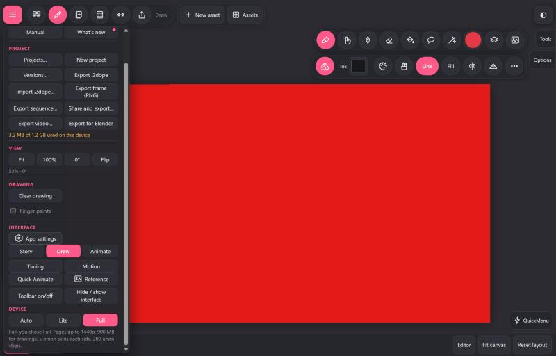
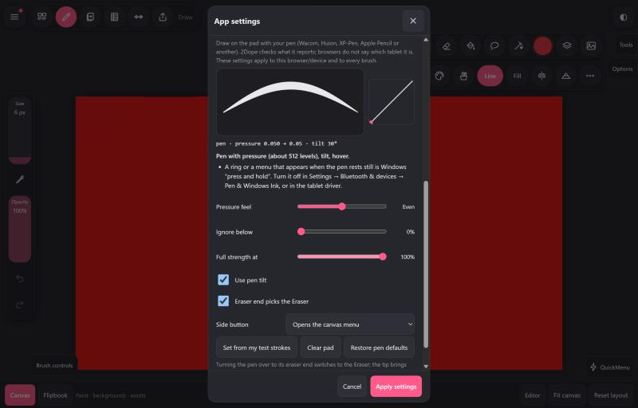

# Testing the new pen and tablet settings

Thanks for testing! This build adds settings for drawing tablets (Wacom, Huion, XP-Pen, Gaomon and others) and for Apple Pencil. It takes about 10 minutes.

**App:** https://dustooned.github.io/2Dope/
If you already had 2Dope open, reload the page first so you get the new version.

## Where to find it

1. Tap **Menu** (top left). Under **Interface**, tap **App settings**.
   
2. Scroll down and open **Pen and tablet**.
   

## What to try

1. **Test pad.** Draw a few strokes on the dark pad with your pen: light, then as hard as you normally draw. Write down:
   - the bold summary line (for example "Pen with pressure (about 8,192 levels), tilt, hover.")
   - any tips listed under it
   - the line above it while you draw (pressure, tilt, Hz)
2. **Eraser end.** If your pen has one, turn it over and draw on the pad: it should erase. Close settings, then flip the pen on the canvas. The tool should switch to the Eraser. Flip back to the tip and draw: your previous tool should come back.
3. **Pressure feel.** Move **Pressure feel** to Soft, then to Firm, and draw on the pad each time. Does the line get thicker more easily on Soft?
4. **Set from my test strokes.** Tap **Clear pad**, draw 3 or 4 strokes at your normal hardest pressure, then tap **Set from my test strokes**. Tap **Apply settings**, then draw on the canvas. Does full pressure feel easier to reach?
5. **Your programmed buttons.** Keep your Wacom buttons as you set them (zoom and erase) and try them on the canvas:
   - **Erase:** hold the button and draw. It should erase, and drawing with the tip alone should bring back your tool.
   - **Zoom:** press it. The canvas (not the whole page) should zoom, and the drawing's timing should stay the same.
   Please tell us exactly what each button is set to in Wacom Tablet Properties → Pen (for example "Keystroke Ctrl +", "Pan/Scroll" or "Erase").
6. **Side button in 2Dope.** Set one Wacom button back to its default (Right Click). In 2Dope, change **Side button** to each choice in turn ("Moves the page", "Zooms", "Erases while held"), tap **Apply settings**, then hold the button and drag on the canvas. Each should do what it says, and no menu should appear.
7. **Tilt.** If your pen tilts, turn **Use pen tilt** off and back on with a pencil-style brush. Does the shading change?
8. **No pressure.** If your lines always stay the same width, did 2Dope show a message about the pen not reporting pressure? Do the tips in Pen and tablet fix it (on Windows, usually by turning on Windows Ink in the tablet driver)?

When you're done, **Restore pen defaults** and then **Apply settings** puts everything back.

## Please send back

- Tablet and pen model, operating system, browser and its version
- On Windows: is **Windows Ink** on or off in the tablet driver? If you can, try both.
- The summary line and tips from step 1
- What worked and what didn't in steps 2–8, with a screenshot of anything that looks wrong
